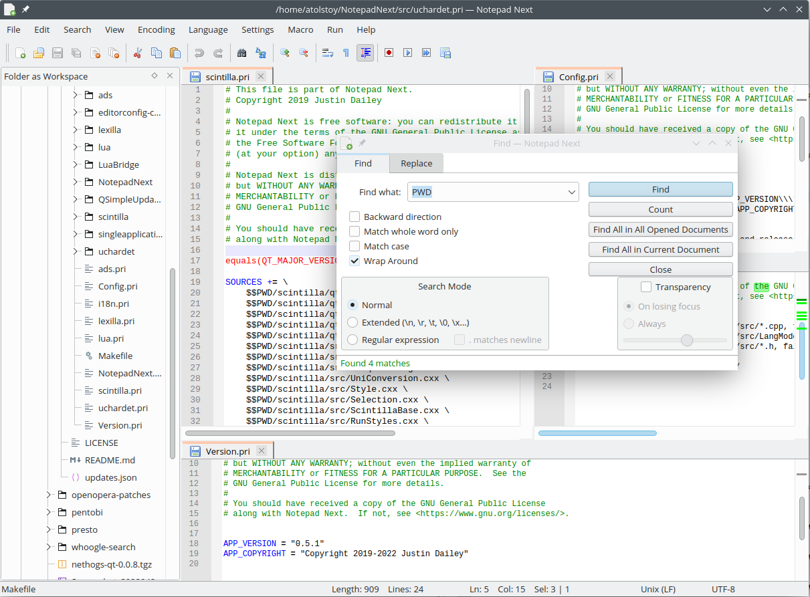
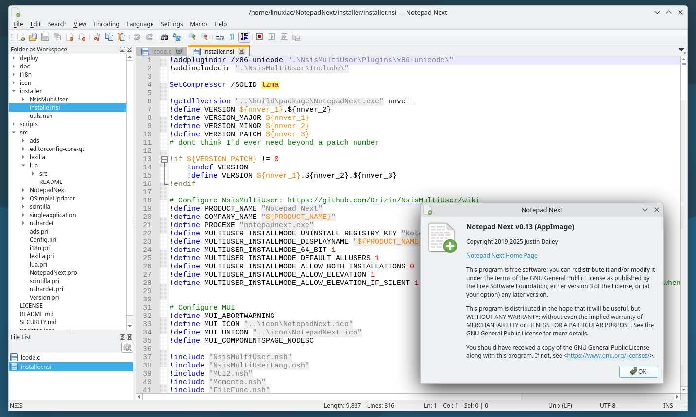

# Notepad Next Cross Platform Text and Code Editing

Notepad Next is a desktop editor for working with plain text and source files.
It reimplements the Notepad++ editing experience across Windows, Linux, and macOS.

[](https://github.com/Notepad-Next/Notepad-Next/releases/)

## What Is Notepad Next?

The Notepad Next text editor combines tabbed documents with familiar code-editing tools.
Use it for reviewing scripts, maintaining configuration files, and making focused text changes.

The project remains under development.
Its maintainers describe it as usable while cautioning against relying on it for critically important work.

### Everyday Editing

- Keep several documents open in tabs.
- Arrange editors in split views.
- Use syntax highlighting to distinguish language elements.
- Find text and review replacements.
- Navigate longer documents with bookmarks.
- Adjust completion behavior to suit the task.

## Editing Workspace

| Task | Relevant control | Suggested approach |
| --- | --- | --- |
| Compare nearby documents visually | Split editor | Keep related sections visible together |
| Reduce tab clutter | Bulk tab closing | Review unsaved changes before closing documents |
| Revisit important lines | Bookmarks | Mark places that need another pass |
| Find earlier matches | Backward search | Use Shift+Enter in the search workflow |
| Read wide lines | Horizontal scrolling | Use Shift+Scroll where supported |
| Collect several matches | Search results copying | Copy selected results for review |
| Work with UTF-16 files | Little- and big-endian support | Check the intended encoding when saving |

Split views provide a way to inspect documents side by side.
They do not by themselves imply an automated difference engine.



## Search and Replace

Find and Replace supports focused changes within an editing session.
Inspect the selected text and intended search scope before applying a replacement.

### A Reviewable Change

1. Search for the original term.
2. Inspect a few representative matches.
3. Decide whether the same replacement fits every occurrence.
4. Apply the intended changes.
5. Review the modified document before saving.

Version v0.15 improves the Find/Replace dialog on smaller screens.
It also allows several search results to be copied together.

### Bookmarked Matches

Searching and bookmarking lines can help organize a review.
Keep bookmarks for locations that need follow-up rather than marking every familiar line.

A useful review sequence is to locate a term, inspect its context, and bookmark unresolved cases.
Return to those positions after completing the first pass.

## Source Code Editing

Syntax highlighting helps separate comments, identifiers, and punctuation.
It supports reading code but does not establish whether the program is correct.

The example below is ordinary C++ text for an editing exercise.
It does not call a Notepad Next scripting API.

```cpp
#include <iostream>

int main() {
    std::cout << "Review before saving\n";
    return 0;
}
```

Open a small source file when checking a language's appearance.
Review indentation, line wrapping, and completion behavior with representative content.

### Completion Controls

Version v0.15 adds a setting for enabling or disabling auto-completion.
Language keyword suggestions are also part of that release's completion improvements.

Choose the setting that suits the document.
Completion suggestions still need review before they become part of a saved file.

## Documents and Encodings

Version v0.15 adds support for UTF-16 Little Endian and UTF-16 Big Endian.
This is useful when exchanging text with software that expects those encodings.

- Identify the encoding expected by the receiving application.
- Check non-ASCII characters after opening the document.
- Review the document again after changing its encoding.
- Keep a copy when testing an unfamiliar file format.

Plain text editing preserves a different set of concerns from rich document editing.
Formatting instructions in a source file remain text unless another application interprets them.

## Platform Packages

Official releases provide packages for the project's three desktop operating systems.
Choose the package that matches the operating system and processor architecture.

| Platform | Published package formats | Architecture notes for v0.15 |
| --- | --- | --- |
| Windows | Installer and standalone ZIP | x64 and initial ARM64 packages |
| Linux | AppImage | x86_64 release asset |
| macOS | DMG | Separate x64 and ARM64 images |

The Windows installer includes additional integration components.
The standalone ZIP offers a separate distribution choice.

The project also documents Flatpak and package-manager distribution options.
Package availability and update timing can differ between distribution channels.

## Build It Yourself

Notepad Next open source development uses C++, Qt, and CMake.
The official build guide describes Qt Creator on Windows and a command-line Linux workflow.

### Build Requirements

| Component | Confirmed project requirement | Purpose |
| --- | --- | --- |
| CMake | 3.21 or newer in the root build configuration | Configure the project |
| C++ compiler | C++20 support | Compile the application |
| Qt | Qt 6; 6.5 is the documented supported version | Desktop interface and platform services |
| Qt modules | Core, Gui, Widgets, Network, PrintSupport, Core5Compat | Required application components |
| Ninja | Used by the documented Linux build | Execute generated build rules |

The Windows guide uses Visual Studio 2022 and a compatible Qt MSVC kit.
Match the compiler architecture to the Qt kit rather than mixing incompatible toolchains.

### Configure a Linux AppImage Build

Run this example from a complete Notepad Next source checkout.
It assumes the Linux build dependencies and Qt development packages are already available.

```bash
export DISTRIBUTION=AppImage
export EXTRA_PLATFORM_PLUGINS="libqwayland-generic.so"
cmake -S . -B build -G Ninja \
  -DCMAKE_BUILD_TYPE=Release \
  -DAPP_DISTRIBUTION="$DISTRIBUTION"
```

These settings follow the project's documented Linux AppImage workflow.
The platform plugin setting supports packaging the listed Wayland plugin.

### Build the AppImage Target

Use the same configured build directory.
This command builds the packaging target rather than merely opening an existing application.

```bash
cmake --build build \
  --target appimage \
  --parallel
```

For the documented Windows workflow, open the project in Qt Creator.
Select a compatible desktop kit and use Qt Creator's build and run action.

## Development and Verification

Notepad Next cross platform development requires checking behavior on the relevant desktop systems.
A successful compilation is one part of verification.



- Check opening, editing, and saving a small temporary document.
- Exercise the affected search or navigation control.
- Recheck the behavior with another document when the change concerns tabs.
- Confirm encoding behavior using text with non-ASCII characters.
- Report reproducible steps together with the application version and operating system.

Community contributions include code changes and translations.
The project manages translations through Crowdin.

## License

Notepad Next is distributed under the GNU General Public License version 3.
Check the license terms when redistributing the application or modified source.

## Related Search Terms

Notepad Next, next notepad, Notepad Next text editor, Notepad Next open source, Notepad Next cross platform, desktop, editor, linux, macos, notepad, notepad-plus-plus, qt, qt6, windows, text-editor
